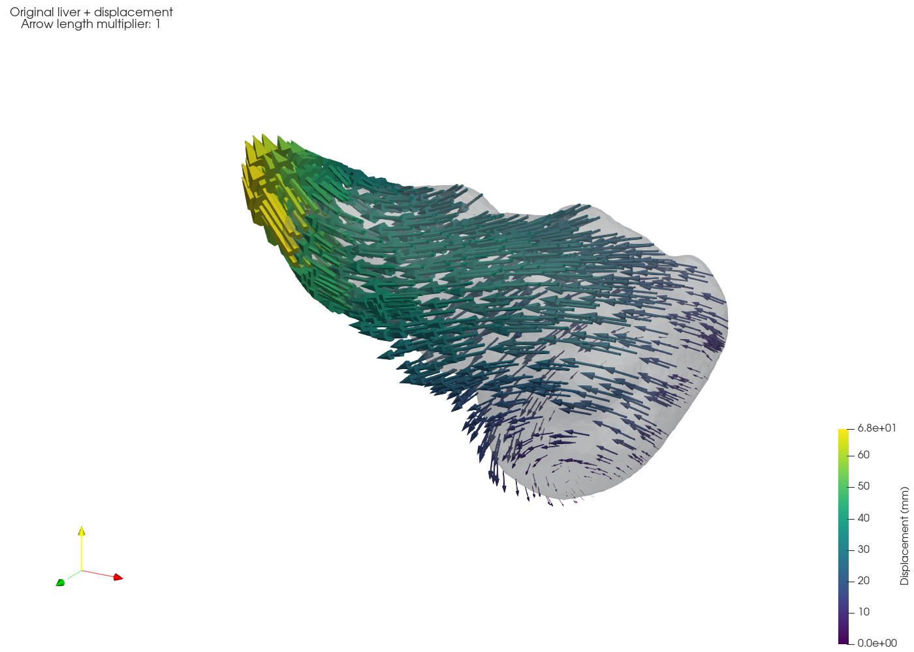

# Liver deformation

Neo-Hookean liver deformation simulations with Elmer and displacement
visualization in ParaView.

## Example



Left: the original mesh, fixed patch in black, and individually colored force
patches with resultant-force arrows (20 mm per newton). Right: each arrow starts
on the original surface and ends at its displaced position; the color bar gives displacement magnitude in millimetres.

The input mesh is included at
[`examples/liver_0_hcp_tet4_metres.vtk`](examples/liver_0_hcp_tet4_metres.vtk).
It is the undeformed liver 0 tetrahedral mesh from MSD-RIT Task03_Liver,
already converted to metres. No separate mesh download or conversion is needed.

Install [Pixi](https://pixi.sh), then run these commands from the repository root:

```bash
pixi install --locked
pixi run install-elmer
pixi install --locked -e visualization

pixi run case examples/liver_0_hcp_tet4_metres.vtk outputs/example \
  --seed 1890913995 --force-factor 3 --youngs-modulus 4512.945159 \
  --poisson-ratio 0.35 --min-force-patches 2 --fixed-area-scale 2 \
  --fixed-margin 0.02 --force-radius-max 0.07 \
  --relaxation-factor 0.05 --nonlinear-max-iterations 200

pixi run -e visualization visualize outputs/example/deformed.vtk \
  --glyph-scale 1 --max-glyphs 1000 --output outputs/example/displacement.png
```

The first installation downloads the dependencies and builds Elmer 26.2.1
locally. The result and visualization are saved under `outputs/example/`;
use a new output directory when rerunning the simulation.

## Deform your own liver

Use a linear tetrahedral `.vtk` or `.vtu` mesh with coordinates **in metres**.
Convert millimetre coordinates to metres before running; `main.py` does not
convert units. Choose a new output directory for each simulation.

```bash
pixi run case /path/to/liver.vtk outputs/liver \
  --seed 1 --force-factor 1.5 --youngs-modulus 3000
```

This samples a fixed surface patch and loading patches, writes the Elmer inputs,
and runs the solver. A successful solve writes `outputs/liver/deformed.vtk`,
containing the deformed coordinates and the `displacement` point-vector array,
both in metres.

Useful options:

| Option | Meaning |
|---|---|
| `--seed 1` | Reproduce the sampled patches, loads, and material draw |
| `--force-factor 1.5` | Scale the sampled forces; this is not a prescribed displacement |
| `--youngs-modulus 3000` | Young's modulus in Pa; otherwise sampled from 500–5000 Pa |
| `--poisson-ratio 0.35` | Material Poisson ratio |
| `--min-force-patches 2` | Sample 2–3 loading patches |
| `--fixed-margin 0.02` | Minimum clearance between fixed and loading patches, in metres |
| `--relaxation-factor 0.1` | Nonlinear solver step multiplier |
| `--nonlinear-max-iterations 200` | Maximum nonlinear solver iterations |
| `--prepare-only` | Write the mesh and solver inputs without solving |

Run `pixi run case --help` for all options. Keeping the mesh, seed, and sampling
settings fixed while changing the force factor preserves the patches and force
directions. The solver uses CG/Cholesky2 without line search or retries.

The output directory also contains `manifest.json` with the sampled settings
and status, `solver.log`, `case.sif`, the native Elmer mesh files, and raw results
under `result/`. A failed preparation or solve is recorded in the manifest.
`deformed.vtk` is written only after convergence and geometry checks pass.

## Visualize displacement

Install the separate ParaView environment once:

```bash
pixi install --locked -e visualization
```

Render the result:

```bash
pixi run -e visualization visualize outputs/liver/deformed.vtk
```

`visualize.py` produces two panels with the same camera. The left panel shows
the original mesh with the fixed patch in black and each force patch in a
different color. One arrow on each force patch shows its resultant applied force,
computed as the saved traction times the patch area. Arrow lengths are
proportional to force magnitude, with a default scale of 20 mm per newton;
`--force-scale` sets this scale in metres per newton. The legend lists the forces
in newtons. The right panel shows a translucent grey original surface with
arrows starting at sampled surface vertices. Arrow directions and lengths show
their displacements; colors show displacement magnitude in millimetres.
The original coordinates are recovered as `deformed coordinates - displacement`.
At the default arrow scale of 1, each arrow tip reaches its deformed position.

The script reads `mesh.boundary`, `mesh.nodes`, and `manifest.json` beside the
deformed mesh; use `--boundary /path/to/mesh.boundary` to specify another location.
It saves `displacement.png`, `displacement.pvsm`, and a labeled surface
`displacement_boundaries.vtk` beside the input mesh. Keep the labeled surface
with the state file so the patch panel can be reopened.
Open the state with ParaView's **File → Load State** to rotate the scene and
adjust its display. On a machine with a graphical display, you can also run:

```bash
pixi run -e visualization paraview --state=outputs/liver/displacement.pvsm
```

For small displacements, enlarge the arrows without changing the simulation:

```bash
pixi run -e visualization visualize outputs/liver/deformed.vtk \
  --glyph-scale 5 --max-glyphs 500 --output outputs/liver/vectors.png
```

The caption reports the arrow multiplier. Colors always show the actual
displacement magnitude. Rendering works without a graphical display; opening
the interactive ParaView application requires one.

## Tests and attribution

Run `pixi run test` for the checks in `tests/`.
The force and patch-size sampling distributions derive from Volume2SurfaceCNN;
its notice is retained in `VOLUME2SURFACECNN_LICENSE.txt`.
